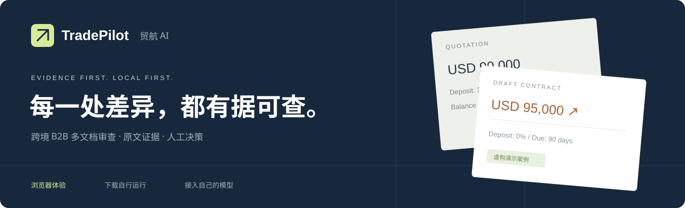
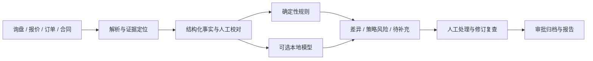
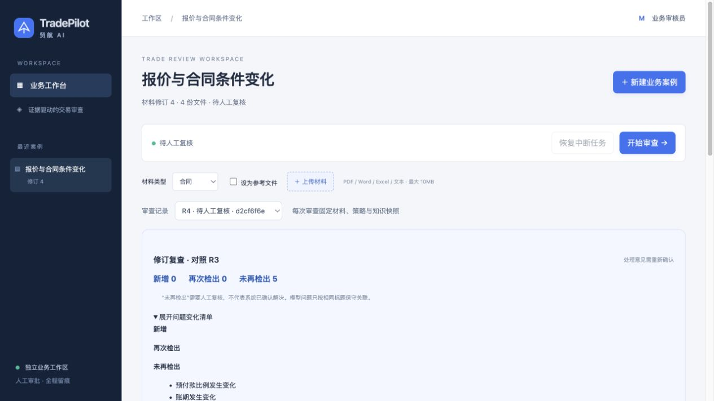

<div align="center">



**跨境 B2B 多文档审查 · 原文证据 · 人工决策 · 在你的设备上运行**

[](https://github.com/lifedaydreamer/ecollm-s1/actions/workflows/ci.yml)


[](LICENSE)

[**打开交互演示 ↗**](https://lifedaydreamer.github.io/ecollm-s1/) · [**快速启动 ↓**](#quick-start) · [**接入本地模型**](docs/SELF_HOSTING.md#model-mode) · [**能力与进度**](docs/STATUS.md)

</div>

---

**客户报价是 USD 90,000，待签合同变成 USD 95,000；预付 30% 变成 0%，账期从 30 天变成 90 天。**

TradePilot 将这些变化与双方原文并排展示，再根据企业策略生成提醒。每条发现都能追溯依据；业务人员处理后，才能审批归档。项目面向中国出口企业的卖方视角，首版以英文材料、中文分析为主。

> **当前版本：可运行工程原型。** 默认是无 GPU 的规则工作台；可选接入使用者自己的 Qwen 模型。**已完成 CUAD 条款抽取实验 Adapter；正式外贸风险模型与真实业务评测仍待完成。** 本仓库、静态演示和默认启动配置均不依赖维护者的服务器。

## 选择你的体验方式

| 方式 | 你能做什么 | 需要什么 | 是否运行大模型 |
| --- | --- | --- | --- |
| [浏览器交互演示](https://lifedaydreamer.github.io/ecollm-s1/) | 切换三个虚构案例、对照原文、查看规则结果、模拟核对、下载演示 JSON | 浏览器 | 否，展示由真实规则引擎生成的固定快照 |
| **本地工作台 · 推荐先试** | 上传自己的文件、运行规则、校对字段、处理发现、审批归档、导出报告 | Docker + Python | 否，无需 GPU |
| **本地模型工作台** | 在上述流程中加入条款抽取、风险判断和语义比较 | Linux / NVIDIA GPU、容器运行时、本地权重 | 是，使用你自己的算力 |

展示页只提供静态内容；文件解析和模型推理在下载后的工作台运行。静态页面不收集文件，不发送推理请求，不包含服务器凭据。

<a id="quick-start"></a>
## 三步启动自己的工作台

先安装并启动 **Docker Desktop**，或 Docker Engine + Compose v2；同时安装 **Python 3.11+** 和 Git。普通电脑即可运行规则模式，首次构建需要联网下载依赖和镜像，**不会下载大模型**。

```bash
git clone https://github.com/lifedaydreamer/ecollm-s1.git
cd ecollm-s1
python3 scripts/demo.py start
```

Windows 可将 `python3` 换成 `python`。没有 Git 也可以使用 GitHub 的 **Code → Download ZIP**，解压后在项目目录执行最后一行。

启动完成后打开 **http://localhost:3100**。用户名为 **`tradepilot`**，密码由启动器在你的设备上随机生成并显示。

1. 点击 **“条件发生变化”** 创建虚构案例。
2. 启动审查，查看 **3 项文件差异 + 2 项策略风险**。
3. 点击引用定位原文，逐项记录处理意见。
4. 阅读规则覆盖限制，人工确认后归档，导出 PDF、DOCX、JSON 或 TXT。

正常案例与材料不足案例也可直接创建。规则模式覆盖明确字段与阈值，不提供完整自然语言条款审查。

```bash
python3 scripts/demo.py password   # 查看自己这份部署的登录信息
python3 scripts/demo.py status     # 查看服务状态
python3 scripts/demo.py logs       # 查看诊断日志
python3 scripts/demo.py stop       # 停止本项目容器，保留案例数据
```

更换端口：修改自动生成的 `.env` 中 `TRADEPILOT_PORT=3100`，再执行 `start`。默认只开放本机访问。账号配置保存在本机 `.env`，案例保存在 Docker 数据卷；两者都不会上传 GitHub。

## 在自己的 GPU 上复现模型模式

不需要连接我们的服务器，也无需训练就能使用原始基座。

1. 按[模型模式指南](docs/SELF_HOSTING.md#model-mode)准备 NVIDIA 容器环境。
2. 从官方源下载 `Qwen/Qwen3-4B-Instruct-2507` 到自己的磁盘；使用[校验清单](configs/model-manifest.json)核验权重。
3. 明确指定已分配给你的 GPU 和本地模型目录：

```bash
python3 scripts/demo.py start \
  --model-dir /absolute/path/Qwen3-4B-Instruct-2507 \
  --gpu GPU-xxxxxxxx-xxxx-xxxx-xxxx-xxxxxxxxxxxx
```

请把示例路径和 UUID 换成真实值。启动器先检查指定 GPU，发现已有计算进程会拒绝加载；不自动换卡，也不会停止别人的任务。训练和推理仍应使用管理员或调度器分配的资源。

后续有自己的专业 Adapter 时，在命令后追加 `--adapter /absolute/path/adapter` 即可加载。**当前仓库没有虚构或占位的“已训练权重”。** 大模型由官方源获取，仓库保存代码、模型文件哈希与运行配置。

相同代码、权重、输入和参数用于尽量复现结果；生成结果可能受硬件、依赖和执行时限影响，不能承诺跨设备逐字一致。规则模式的三个预览案例有 CI 一致性校验。

## 一条完整的审查链路



| 能力 | 当前交付 |
| --- | --- |
| 文档处理 | 文本 PDF、DOCX、XLSX、TXT / MD / CSV；保留页码、段落或单元格位置 |
| 版本与证据 | 原文件版本、哈希去重、原文引用校验、字段人工纠正记录 |
| 规则审查 | 明确字段差异、预付款 / 账期策略、显式行项目算术与日期格式检查 |
| 人机协同 | 人工中断、逐项处理、审批关口、材料变化后旧审批失效 |
| 本地模型 | 独立 `extract` / `review` / `compare` API；原始 Qwen + 可选 PEFT Adapter |
| 导出 | PDF、DOCX、JSON、TXT；修改建议需要人工确认 |

## 本轮新增：从差异发现走到修订复查

- **商品逐项核对**：按显式 SKU 比较数量与单价，单位、币种或对应关系有疑点时转人工核验。
- **修订前后对照**：展示新增、再次检出和未再检出的问题；保留历史原文与处理记录，新版本独立审批。
- **企业策略可配置**：在工作台调整预付款与账期阈值，保存后要求重新审查。
- **依据看得见**：展开企业阈值、原创复核清单与官方来源摘要，查看来源、版本和适用条件。
- **模型引用更严格**：跨文档差异需要双边证据；页码/位置来自原文块，不能由模型任意填写。

商品行示例：`SKU: CUP-01 | Quantity: 10 | Unit: pcs | Unit price: USD 12 | Line total: USD 120`。当前不自动换算单位，也不把“未再检出”视为已解决。



参赛差距、优先级和下一轮验收见[竞赛竞争力分析与优化记录](docs/COMPETITION_READINESS.md)。

## 专业模型试训

新增面向 CUAD 九类商业合同条款的独立 LoRA 实验：保留专家引句、按来源分组、基座与 Adapter 同条件对照。它先验证条款抽取能力，不能把其结果直接称为外贸风险准确率；正式业务模型需通过后续专项验证。本次实验 Adapter 使用 `ml/predict_clause.py` 独立入口；当前工作台继续使用原始模型，待工具接口适配后再接入。

本轮 711 条训练任务、72 条冻结测试任务：证据 token F1 **58.05% → 73.00%**；九类条款存在判断 Macro-F1 **58.32% → 88.66%**。这是过滤后的公开商业合同片段子集成绩，不能当作完整 Agent 或外贸风险准确率。

[查看真实训练与对照报告](docs/TRAINING_REPORT.md) · [训练路线与方向二交付条件](docs/TRAINING_STRATEGY.md)。训练只在具有获配 GPU 的服务器运行，普通电脑默认 Demo 不受影响。

## 验证与边界

CI 检查后端行为、前端生产构建、预览与规则结果一致性，并从全新 Docker 环境走通三个案例的认证、审查、审批和导出。GPU 推理不在普通 CI 中执行。新增的 28 场景 API 工程回归也在 CI 执行并保存逐场景报告；这是受控同源模板回归，不代表独立专业测试成绩。

已完成的原始模型工程验证包括三个任务接口和一个虚构案例完整流程；**它们不是独立效果评测**。专业数据集、QLoRA 训练、100 个 Agent 案例、消融实验和用户试用仍待建设。

- 扫描 PDF 会提示需要 OCR，尚未集成完整扫描件解析。
- 当前为单工作区、单业务进程；适合自行运行和演示，多用户服务需要补权限隔离与并发队列。
- 语义上下文有长度和参考文件数量限制，覆盖不足会在报告中提示。
- 知识库含 11 条原创清单和官方来源摘要；具体法律适用、完整 BGE / pgvector 检索仍待专业复核与验收。

完整信息见[实施状态](docs/STATUS.md)、[验证记录](docs/VALIDATION.md)与[阶段任务](docs/ROADMAP.md)。

## 开发与项目结构

```text
showcase/          浏览器交互预览：无后端、无模型请求
web/               Next.js 工作台
tradepilot/        API、解析、规则、模型接口、工作流与报告
scripts/           一键启动、权重下载校验、数据、训练和评测入口
configs/           模型制品清单与训练配置
tests/             业务与可分发 Demo 回归
docs/              自部署、标注、验证与阶段状态
compose*.yaml      无 GPU 默认配置 / 可选 GPU 模型配置
```

开发者安装与运行测试：

```bash
python3.12 -m venv .venv
.venv/bin/pip install -r requirements.lock
.venv/bin/pip install --no-deps -e .
.venv/bin/python -m pytest -q
.venv/bin/python scripts/build_preview.py --check
.venv/bin/python scripts/benchmark_agent.py --output .data/agent-regression.json
cd web
npm ci
npm run build
```

前端构建使用 Node.js 22。`model-requirements.lock` 是已验证 GPU 环境的快照，不是跨平台默认安装清单。更多配置见[自行运行指南](docs/SELF_HOSTING.md)。

## 许可与数据

项目代码采用 [MIT License](LICENSE)。Qwen 基座遵循其[官方模型许可](https://huggingface.co/Qwen/Qwen3-4B-Instruct-2507)，其他依赖保留各自许可。演示材料为程序自建虚构案例；真实合同、登录密钥、模型权重和运行数据库不提交到仓库。

<div align="center">

**TradePilot · 贸航 AI**  
让原文、判断与决定，保持在同一条证据链上。

</div>
