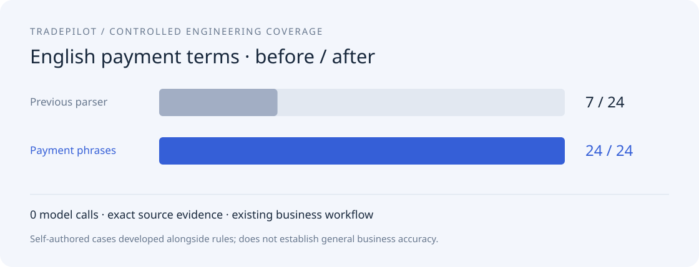
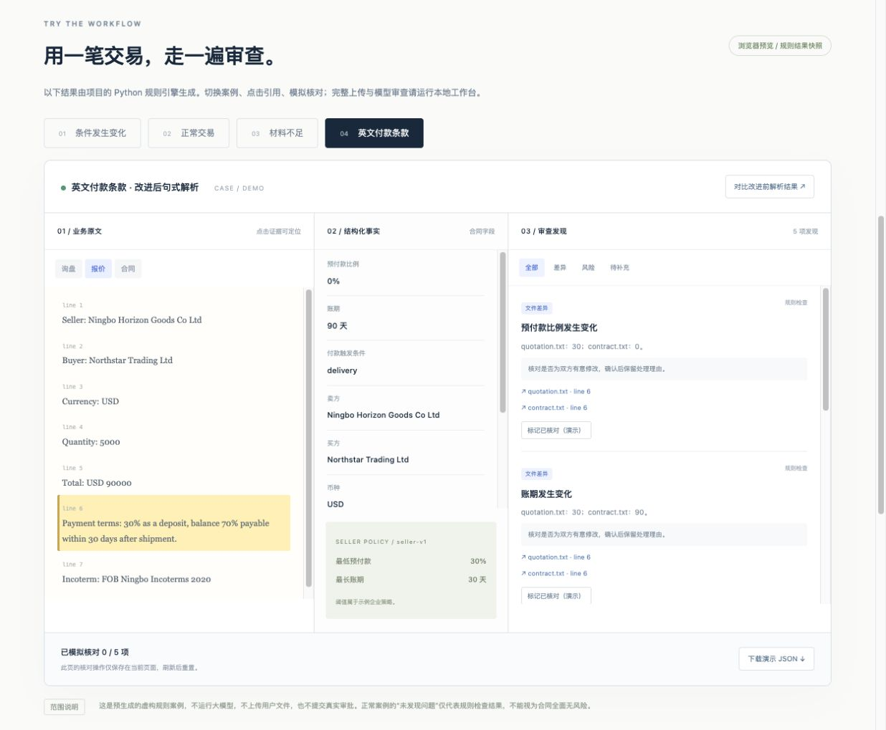

# 英文付款条款：可复核的前后对比

2026-10-20，CPU 规则模式，无模型调用。

本轮将英文业务材料中常见的预付款、尾款期限和付款触发事件接入原有的事实层、跨文档比较与企业策略检查。以前需要 `Deposit: 30%` 等标签式字段，现在也能处理以下常见句式：

> Payment terms: 30% as a deposit, balance 70% payable within 30 days after shipment.

提取为预付款 **30%**、账期 **30 天**、触发事件 **shipment**；每个字段保留原文引用。合同改为 `0% deposit, balance 100% payable within 90 days after delivery` 时，可检出 **3 项条件差异与 2 项策略提醒**。

[打开第四个交互案例](https://lifedaydreamer.github.io/ecollm-s1/#payment)。进入案例后可点击“对比改进前解析结果”，在同一份材料上切换旧版和新版。页面使用真实规则引擎生成的虚构案例快照；下载工作台后可上传自己的文件运行这些规则。





## 实际记录

| 指标 | 原标签式解析 | 新增付款句式解析 |
|---|---:|---:|
| 完整匹配的案例数 | 7 / 24 | 24 / 24 |
| 完整匹配率 | 29.17% | 100% |
| 字段 Micro-F1 | 15.09% | 100% |
| 已输出字段的原文引用匹配率 | 100% | 100% |
| 模型调用 | 0 | 0 |

另有 **37 项后端测试、28 / 28 个原有业务回归场景**通过。实际逐案例结果见 [JSON 记录](validation/payment-before-after.json)，输入见 [24 个受控案例](../data/benchmarks/payment-terms.json)。

**这组案例是与规则一起设计的工程覆盖测试，不是独立准确率评测。** 不能将 100% 写成“外贸合同理解准确率”。旧版的 7 个通过案例多数是应不输出字段的负例；字段 Micro-F1 同时报告，避免仅看案例匹配率造成误解。

## 边界处理

- 支持明确比例、明确日数，以及 shipment / delivery / invoice / acceptance 等触发事件；同义表述先规范化。
- 范围、上下限、附条件或替代方案保留待核验提示；缺少日期触发事件时不猜测。
- 退款、利息、检验和质保中的数字不能作为正常付款条件。
- 同一字段存在多种值时保留冲突，不能自动选一个值作为唯一事实。
- 这些规则不执行完整法律语义审查，也不自动判断付款条件是否被双方接受。

## 复现

安装 README 中的业务依赖后，在项目目录执行：

```bash
python scripts/benchmark_payment_terms.py --output .data/payment-before-after.json
python scripts/build_preview.py --check
pytest -q
```

基准脚本使用同一输入分别调用保留的原标签式解析器与新解析器，并检查字段集合及原文引用。CI 保存逐案例结果。字段标准化、发现处理与审批逻辑共用原有业务流程。
